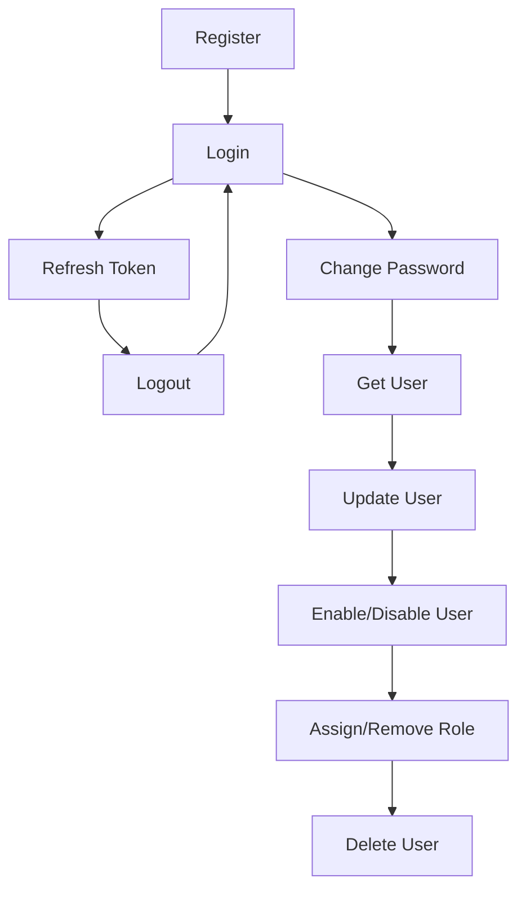

# User Access API - Developer Guide

This document provides comprehensive API reference and usage examples for the User Access API.

**Base URL:** `http://localhost:8083/api/v1/users`

---

## User Management API Reference

### POST /register
Register a new user.

**Request Body:**
```json
{
    "username": "mike",
    "email": "mike@test.com",
    "firstName": "Mike",
    "lastName": "Ross",
    "password": "Password@123",
    "role": "DEVELOPER"
}
```

**Response:** Success message or conflict error if username/email already exists.

---

### POST /login
Authenticate a user and obtain tokens.

**Request Body:**
```json
{
    "username": "mike",
    "password": "Password@123"
}
```

**Response:** JWT `accessToken` and `refreshToken`.

---

### POST /refresh-token
Obtain a new access token using a refresh token.

**Request Body:**
```json
{
    "refreshToken": "<refresh-token>"
}
```

**Response:** New `accessToken` (and potentially new `refreshToken`).

---

### POST /logout
Log out the user and revoke the refresh token.

**Request Body:**
```json
{
    "refreshToken": "<refresh-token>"
}
```

---

### POST /change-password
Change a user's password.

**Request Body:**
```json
{
    "username": "mike",
    "currentPassword": "Password@123",
    "newPassword": "Password@456"
}
```

---

### GET /{username}
Retrieve user information.

**Example:**
```bash
GET /mike
```

**Response:** User details (non-sensitive data only).

---

### PUT /{username}
Update user profile information.

**Example:**
```bash
PUT /mike
```

**Request Body:**
```json
{
    "email": "mike@test.com",
    "firstName": "Michael",
    "lastName": "Ross"
}
```

---

### DELETE /{username}
Delete a user account.

**Example:**
```bash
DELETE /mike
```

---

### PATCH /{username}/enable
Enable a disabled user.

**Example:**
```bash
PATCH /mike/enable
```

---

### PATCH /{username}/disable
Disable a user account.

**Example:**
```bash
PATCH /mike/disable
```

---

### POST /{username}/roles
Assign a role to a user.

**Example:**
```bash
POST /mike/roles
```

**Request Body:**
```json
{
    "role": "ADMIN"
}
```

---

### DELETE /{username}/roles
Remove a role from a user.

**Example:**
```bash
DELETE /mike/roles
```

**Request Body:**
```json
{
    "role": "ADMIN"
}
```

---

## Typical User Flow



---

## Available Roles

| Role | Description |
|------|-------------|
| `ADMIN` | Full administrative access across all APIs |
| `DEVELOPER` | Can create/modify schemas, test APIs (no user management) |
| `USER` | Regular application user access |
| `VIEWER` | Read-only access for auditors and reports |

---

## Common HTTP Response Codes

| Code | Meaning |
|------|---------|
| `200 OK` | Request successful |
| `201 Created` | Resource created |
| `400 Bad Request` | Invalid request payload |
| `401 Unauthorized` | Invalid or missing credentials |
| `403 Forbidden` | Insufficient permissions |
| `409 Conflict` | Resource already exists (e.g., duplicate username) |
| `404 Not Found` | Resource doesn't exist |
| `500 Internal Server Error` | Server-side error |